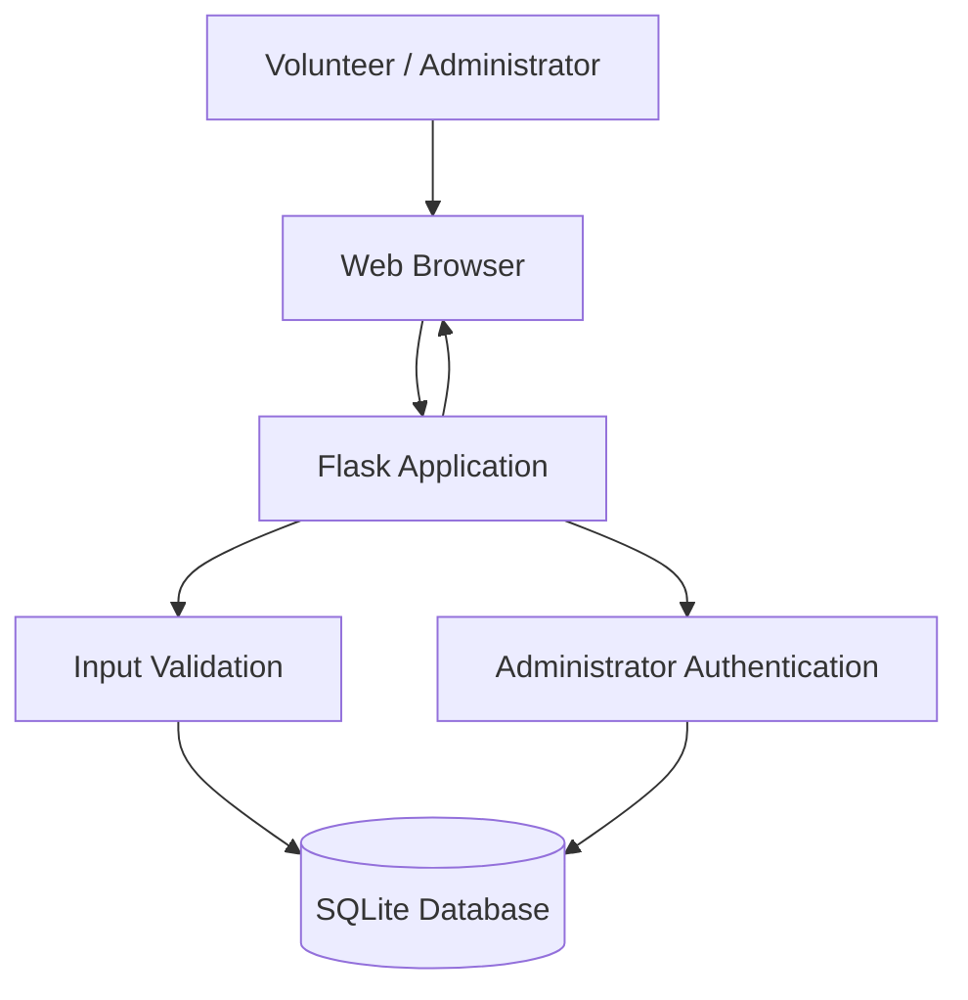
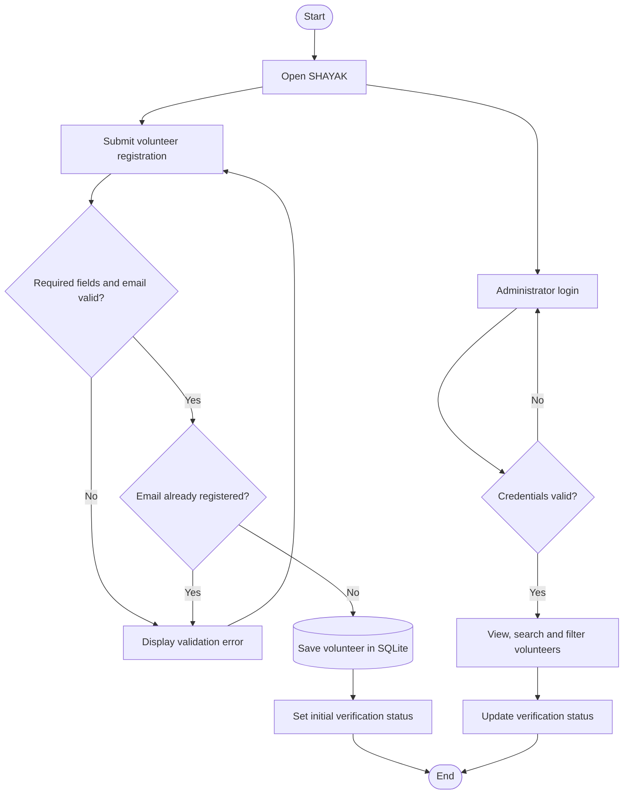
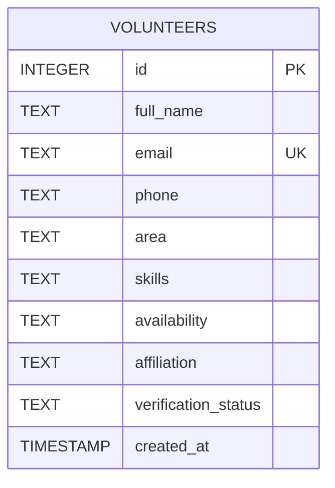

# SHAYAK — Technical Design Document

## 1. Overview

SHAYAK is a Flask-based web prototype for community volunteer registration and administrator-managed volunteer coordination. It is intended to support disaster preparedness and community resilience.

## 2. Technology Stack

- Backend: Python and Flask
- Frontend: HTML and CSS
- Database: SQLite
- Database access: Python `sqlite3`
- Authentication: Session-based administrator login
- Configuration: Environment variables
- Version control: Git and GitHub

## 3. System Architecture

The application follows a simple client-server architecture.

### Component Responsibilities

- **Web browser:** Displays registration and administration pages.
- **Flask application:** Handles HTTP requests and renders HTML templates.
- **Input validation:** Checks required registration fields and basic email format.
- **Administrator authentication:** Checks configured credentials and maintains a login session.
- **SQLite database:** Stores volunteer information and verification statuses.
- **HTML/CSS templates:** Provide the user interface.

## 4. Application Workflow

## 5. Database Design

### Table: `volunteers`

| Column | Type | Description |
|---|---|---|
| id | INTEGER | Primary key; auto-incrementing |
| full_name | TEXT | Volunteer name; required |
| email | TEXT | Volunteer email; required and unique |
| phone | TEXT | Contact number; required |
| area | TEXT | Volunteer area; required |
| skills | TEXT | Skills offered; required |
| availability | TEXT | Volunteer availability; required |
| affiliation | TEXT | Optional organization or affiliation |
| verification_status | TEXT | Volunteer verification state |
| created_at | TIMESTAMP | Registration timestamp |

### Database Relationships

The current prototype uses one table and does not require relational joins.

The database file is `shayak.db` and is located alongside `app.py`.

## 6. Main Application Routes

| Route | Method | Purpose |
|---|---|---|
| `/` | GET | Display the home page |
| `/register` | GET, POST | Display and process volunteer registration |
| `/admin/login` | GET, POST | Display and process administrator login |
| `/admin/volunteers` | GET | Display, search and filter volunteers |
| `/admin/volunteers/<id>/status` | POST | Update a volunteer's verification status |
| `/admin/logout` | GET | Clear the administrator session |
| `/api/status` | GET | Return backend status information |

## 7. Verification Statuses

The intended administrator-managed statuses are:

- Pending verification
- Verified
- Rejected

Only the allowed status values should be accepted when updating a volunteer.

## 8. Configuration and Security

The application reads these environment variables:

- `SHAYAK_SECRET_KEY`: Flask session-signing secret.
- `SHAYAK_ADMIN_USERNAME`: Administrator username.
- `SHAYAK_ADMIN_PASSWORD`: Administrator password.

Security measures include:

- Parameterized SQL queries for database operations.
- A unique database constraint on volunteer email.
- Server-side required-field and basic email validation.
- Session checks for administrator-only pages.
- Validation of allowed volunteer status values.
- Configuration of credentials outside the source code.

Production hardening should include disabling Flask debug mode, using HTTPS, adding CSRF protection, and using stronger administrator password storage and authentication controls.

## 9. Error Handling

The application handles invalid registration data, duplicate email addresses, invalid administrator credentials, unauthorized administration requests, invalid status values, and database errors.

## 10. Testing Strategy

The project should be tested for successful registration, invalid input, duplicate emails, administrator authentication, access control, volunteer search, status filtering, and status updates.

See `tests/test_cases.md` for the test checklist and expected results.

## 11. Current Limitations

SHAYAK is a prototype and is not a live emergency dispatch service. It does not currently implement real-time location tracking, automatic emergency alerts, or guaranteed emergency assistance.

## 12. Future Enhancements

- Incident and emergency reporting
- Location-based volunteer matching
- Emergency alerts and notifications
- Automated test coverage
- Stronger authentication and deployment security
